# [📈 Live Status](https://docmaasi.github.io/status): <!--live status--> **🟩 All systems operational**

Live status for Smith App Studio apps and websites, checked every five minutes. Outages open an issue here automatically and close when the site is back.

<!--start: status pages-->
<!-- This summary is generated by Upptime (https://github.com/upptime/upptime) -->
<!-- Do not edit this manually, your changes will be overwritten -->
<!-- prettier-ignore -->
| URL | Status | History | Response Time | Uptime |
| --- | ------ | ------- | ------------- | ------ |
|  [Smith App Studio](https://www.smithappstudio.com) | 🟩 Up | [smith-app-studio.yml](https://github.com/docmaasi/status/commits/HEAD/history/smith-app-studio.yml) | 

 132ms
     
 | 

<a href="https://docmaasi.github.io/status/history/smith-app-studio">100.00%</a>
    

|  [Grant Desk](https://mygrantdesk.com) | 🟩 Up | [grant-desk.yml](https://github.com/docmaasi/status/commits/HEAD/history/grant-desk.yml) | 

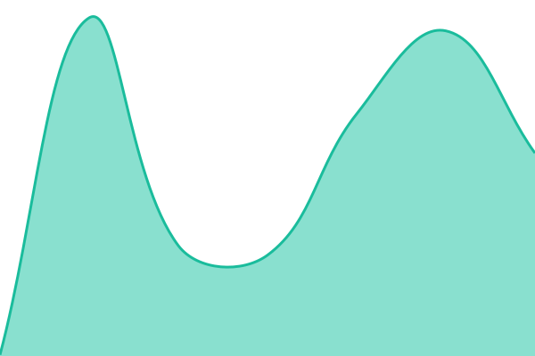 185ms
     
 | 

<a href="https://docmaasi.github.io/status/history/grant-desk">100.00%</a>
    

|  [FamilyCare (website)](https://familycare.help) | 🟩 Up | [family-care-website.yml](https://github.com/docmaasi/status/commits/HEAD/history/family-care-website.yml) | 

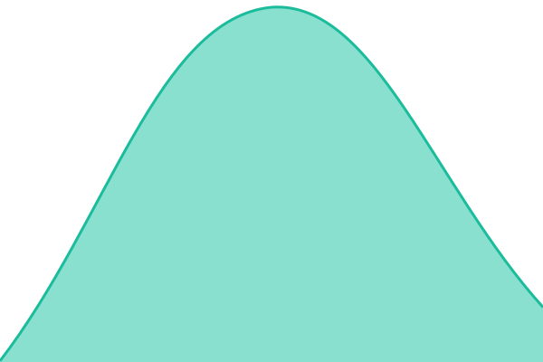 161ms
     
 | 

<a href="https://docmaasi.github.io/status/history/family-care-website">100.00%</a>
    

|  [FamilyCare (app)](https://app.familycare.help) | 🟩 Up | [family-care-app.yml](https://github.com/docmaasi/status/commits/HEAD/history/family-care-app.yml) | 

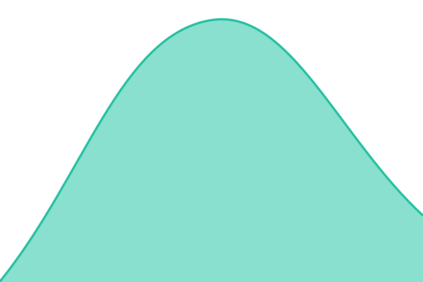 193ms
     
 | 

<a href="https://docmaasi.github.io/status/history/family-care-app">100.00%</a>
    

|  [FamilyCare Facility](https://familycarefacility.com) | 🟩 Up | [family-care-facility.yml](https://github.com/docmaasi/status/commits/HEAD/history/family-care-facility.yml) | 

 129ms
     
 | 

<a href="https://docmaasi.github.io/status/history/family-care-facility">100.00%</a>
    

|  [CoParent](https://coparent.help) | 🟩 Up | [co-parent.yml](https://github.com/docmaasi/status/commits/HEAD/history/co-parent.yml) | 

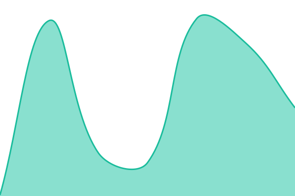 114ms
     
 | 

<a href="https://docmaasi.github.io/status/history/co-parent">100.00%</a>
    

|  [ExamPilot](https://exampilot.help) | 🟩 Up | [exam-pilot.yml](https://github.com/docmaasi/status/commits/HEAD/history/exam-pilot.yml) | 

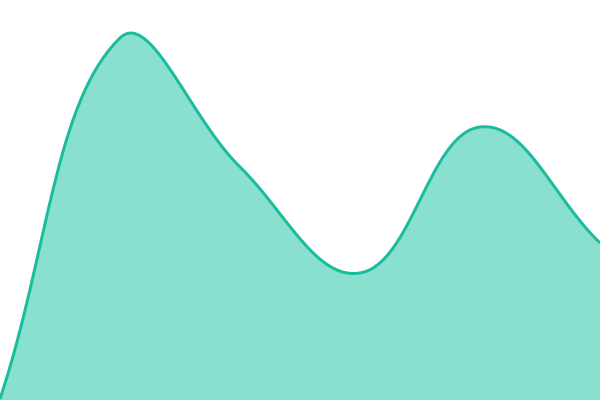 233ms
     
 | 

<a href="https://docmaasi.github.io/status/history/exam-pilot">100.00%</a>
    

|  [Inmigrante](https://inmigrante.help) | 🟩 Up | [inmigrante.yml](https://github.com/docmaasi/status/commits/HEAD/history/inmigrante.yml) | 

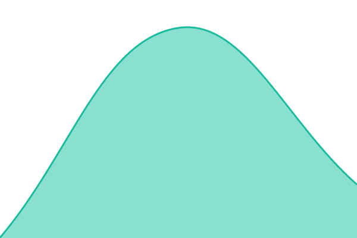 538ms
     
 | 

<a href="https://docmaasi.github.io/status/history/inmigrante">100.00%</a>
    

|  [Payless Help](https://paylesshelp.com) | 🟩 Up | [payless-help.yml](https://github.com/docmaasi/status/commits/HEAD/history/payless-help.yml) | 

 319ms
     
 | 

<a href="https://docmaasi.github.io/status/history/payless-help">100.00%</a>
    

|  [PostPilot](https://postpilot.help) | 🟩 Up | [post-pilot.yml](https://github.com/docmaasi/status/commits/HEAD/history/post-pilot.yml) | 

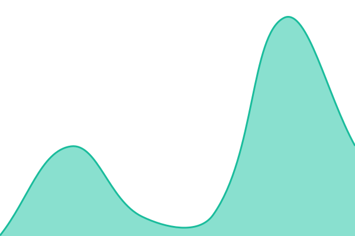 173ms
     
 | 

<a href="https://docmaasi.github.io/status/history/post-pilot">100.00%</a>
    

|  [ProfilePhoto](https://profilephoto.help) | 🟩 Up | [profile-photo.yml](https://github.com/docmaasi/status/commits/HEAD/history/profile-photo.yml) | 

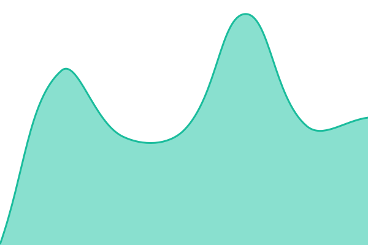 208ms
     
 | 

<a href="https://docmaasi.github.io/status/history/profile-photo">100.00%</a>
    

|  [ProfitSignal](https://profitsignal.help) | 🟩 Up | [profit-signal.yml](https://github.com/docmaasi/status/commits/HEAD/history/profit-signal.yml) | 

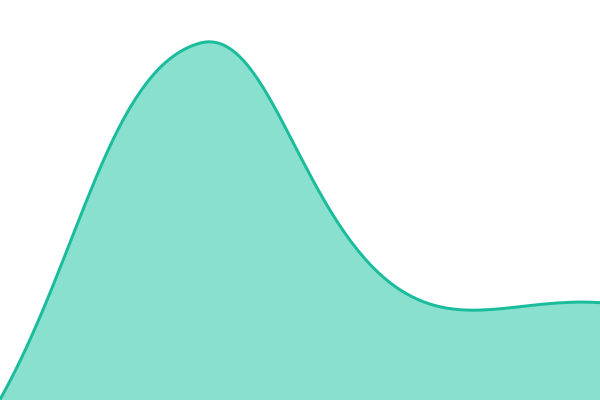 407ms
     
 | 

<a href="https://docmaasi.github.io/status/history/profit-signal">100.00%</a>
    

|  [TrueID](https://trueid.help) | 🟩 Up | [true-id.yml](https://github.com/docmaasi/status/commits/HEAD/history/true-id.yml) | 

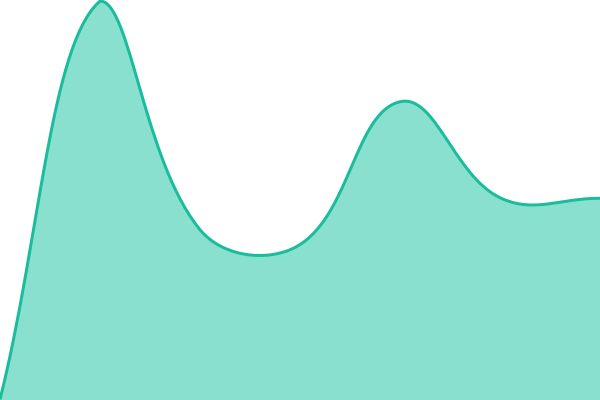 416ms
     
 | 

<a href="https://docmaasi.github.io/status/history/true-id">100.00%</a>
    

|  [Zari](https://zari.help) | 🟩 Up | [zari.yml](https://github.com/docmaasi/status/commits/HEAD/history/zari.yml) | 

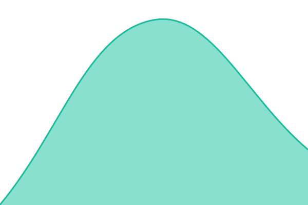 371ms
     
 | 

<a href="https://docmaasi.github.io/status/history/zari">100.00%</a>
    

|  [Nexaria Digital](https://nexariadigital.com) | 🟩 Up | [nexaria-digital.yml](https://github.com/docmaasi/status/commits/HEAD/history/nexaria-digital.yml) | 

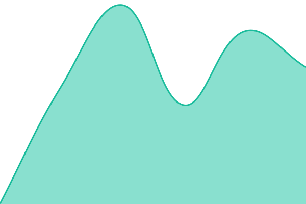 550ms
     
 | 

<a href="https://docmaasi.github.io/status/history/nexaria-digital">100.00%</a>
    

|  [Tending Circle](https://tendingcircle.com) | 🟩 Up | [tending-circle.yml](https://github.com/docmaasi/status/commits/HEAD/history/tending-circle.yml) | 

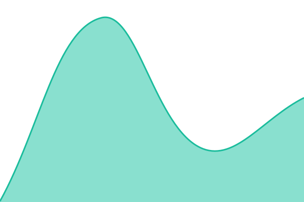 146ms
     
 | 

<a href="https://docmaasi.github.io/status/history/tending-circle">100.00%</a>
    

|  [Marquee VR](https://marqueevr.com) | 🟩 Up | [marquee-vr.yml](https://github.com/docmaasi/status/commits/HEAD/history/marquee-vr.yml) | 

 614ms
     
 | 

<a href="https://docmaasi.github.io/status/history/marquee-vr">100.00%</a>
    

|  [Snotty's World](https://snottys.com) | 🟩 Up | [snotty-s-world.yml](https://github.com/docmaasi/status/commits/HEAD/history/snotty-s-world.yml) | 

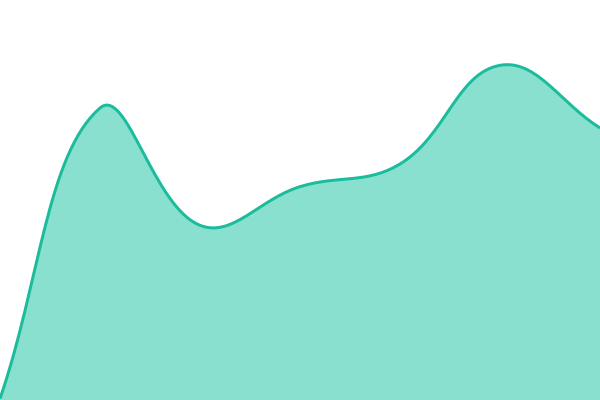 190ms
     
 | 

<a href="https://docmaasi.github.io/status/history/snotty-s-world">100.00%</a>
    

|  [My Bad Feet](https://mybadfeet.com) | 🟩 Up | [my-bad-feet.yml](https://github.com/docmaasi/status/commits/HEAD/history/my-bad-feet.yml) | 

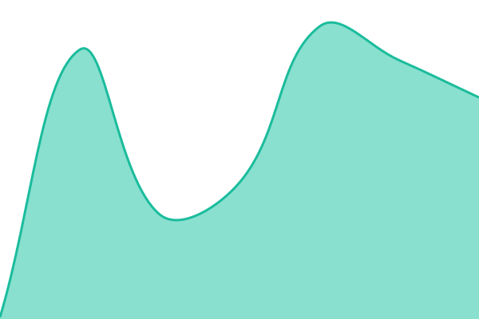 121ms
     
 | 

<a href="https://docmaasi.github.io/status/history/my-bad-feet">100.00%</a>
    

|  [Smith Health TV](https://pro.smithhealthtv.com) | 🟩 Up | [smith-health-tv.yml](https://github.com/docmaasi/status/commits/HEAD/history/smith-health-tv.yml) | 

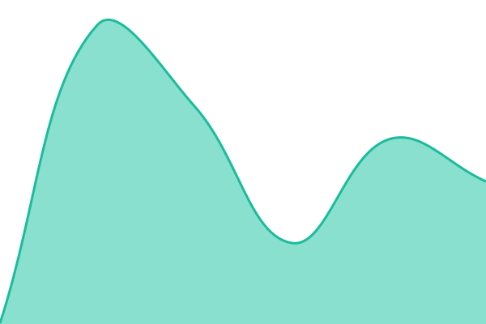 237ms
     
 | 

<a href="https://docmaasi.github.io/status/history/smith-health-tv">100.00%</a>
    

|  [Doorstep](https://doorstep.smithappstudio.com) | 🟩 Up | [doorstep.yml](https://github.com/docmaasi/status/commits/HEAD/history/doorstep.yml) | 

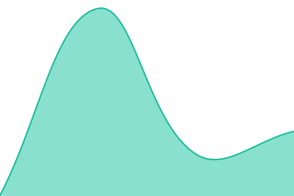 146ms
     
 | 

<a href="https://docmaasi.github.io/status/history/doorstep">100.00%</a>
    

|  [Feet Naturally](https://feetnaturally.com) | 🟩 Up | [feet-naturally.yml](https://github.com/docmaasi/status/commits/HEAD/history/feet-naturally.yml) | 

 175ms
     
 | 

<a href="https://docmaasi.github.io/status/history/feet-naturally">100.00%</a>
    

|  [MatrixROI](https://matrixroi.com) | 🟩 Up | [matrix-roi.yml](https://github.com/docmaasi/status/commits/HEAD/history/matrix-roi.yml) | 

 860ms
     
 | 

<a href="https://docmaasi.github.io/status/history/matrix-roi">100.00%</a>
    

|  [Veylora](https://veylora.studio) | 🟩 Up | [veylora.yml](https://github.com/docmaasi/status/commits/HEAD/history/veylora.yml) | 

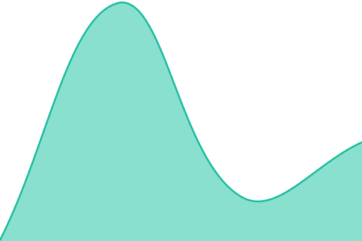 204ms
     
 | 

<a href="https://docmaasi.github.io/status/history/veylora">100.00%</a>
    

<!--end: status pages-->

[**Visit the status page →**](https://docmaasi.github.io/status) · [smithappstudio.com](https://www.smithappstudio.com)

## License

See [LICENSE](./LICENSE). Data in `./history`: [ODbL](https://opendatacommons.org/licenses/odbl/1-0/).
